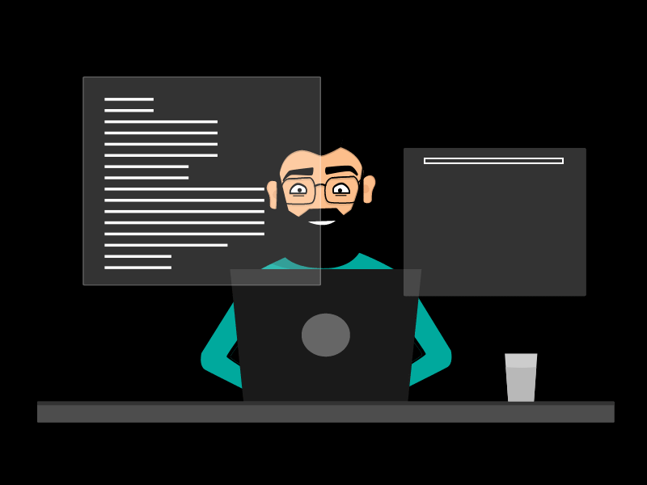

<div align="center">

<!-- Animated Header Banner -->


<!-- GIF / Visual Branding -->


<br>

<!-- Dynamic Typing Animation -->
<a href="https://git.io/typing-svg">
  
</a>

<br><br>

<!-- Gateway & Social Links -->
<a href="https://alireza-abedi.ir/">
  
</a>
&nbsp;
<a href="https://www.linkedin.com/in/alireza-abedi-714280235">
  
</a>
&nbsp;
<a href="mailto:alireza.abedi9310@gmail.com">
  
</a>
&nbsp;
<a href="https://www.coffeebede.com/alirezaabd-dev">
  
</a>

<br><br>

<!-- Visitor Counter -->


</div>

<br>

<!-- About Section -->
## 👨‍💻 About Me

I am a **Full-Stack & Systems Engineer** with a strong focus on **Systems Architecture**, **Applied AI Applications**, and **High-Efficiency Software Engineering**. I design and build mission-critical products that seamlessly bridge robust backend infrastructure, responsive client architectures, and cutting-edge artificial intelligence.

My engineering philosophy combines the speed and memory-safety of **Rust**, the industrial enterprise strength of **C# / .NET**, and the agility of modern **TypeScript / Next.js**, coupled with **Generative AI & LLM integration** to create software that is fast, resilient, and intelligent.

- 🤖 **Applied AI & LLM Systems**: Architecting production AI pipelines — combining LLM semantic comprehension (Gemini Pro, OpenAI) with deterministic finite state machines, stage-scoped prompt engineering, and Vision OCR verification.
- ⚡ **Extreme Performance Engineering**: Creator of [NEXA Mission Control](https://github.com/AlirezaAbd-dev/NEXA-Mission-Control), a self-hosted project management platform engineered in Rust & React that ships in a 42MB Docker image and consumes only ~30MB of RAM.
- 🌐 **Modern Full-Stack Mastery**: Building enterprise web applications using Feature-Driven Architecture, TanStack React Query, Zustand, Next.js App Router, and cross-platform touch-first PWAs.
- 🏗️ **Distributed Systems & DevOps**: Implementing Clean Architecture, Domain-Driven Design (DDD), Outbox patterns, and zero-downtime CI/CD deployment pipelines on Linux VPS servers.
- 💬 **Ask me about**: `AI Architecture & LLM Orchestration`, `Rust (Axum)`, `C# / .NET Core`, `NestJS / TypeScript`, and `Docker Optimization`.

---

<!-- AI & NEXA Engineering Highlights -->
## 🧠 AI Engineering & Intelligent Systems

I build real-world AI applications that go far beyond basic API wrappers, designing resilient architectures where non-deterministic AI models operate reliably within strict business domains:

```
┌────────────────────────────────────────────────────────────────────────────────────────┐
│                              PRODUCTION AI ARCHITECTURE                               │
│                                                                                        │
│  [ Multichannel Inbound ] ──> Rust Webhook Edge (Low-latency parser & deduplication)  │
│                                           │                                            │
│  [ Semantic Interpretation ] ──> Stage-Scoped Prompt Builder (Turn-aware context)     │
│                                           │                                            │
│  [ Hybrid State Machine ]  ──> Deterministic Decision Reducer (Guaranteed business rules)│
│                                           │                                            │
│  [ Multimodal Vision OCR ] ──> Bank slip & receipt verification with Vision AI        │
│                                           │                                            │
│  [ Reliable Outbox Delivery ] ──> Transactional Outbox Pattern for guaranteed dispatch │
└────────────────────────────────────────────────────────────────────────────────────────┘
```

### Key AI Competencies & Capabilities:
* **Hybrid AI + Deterministic State Reducers**: Designed architectures (such as the *NEXA AI Sales Assistant*) pairing probabilistic LLMs with deterministic finite state machines (`SalesDecisionReducer`), guaranteeing zero hallucinations in transactions, inventory, and order checkouts.
* **Stage-Scoped Dynamic Prompting**: Engineering turn-by-turn prompt orchestration (`SalesStagePromptBuilder`) that generates targeted, lean prompts based on current customer lifecycle stages rather than unmanageable monolithic prompts.
* **Multimodal AI & Vision Document Processing**: Implemented automated receipt, invoice, and payment slip verification pipelines using Vision LLMs and Base64 OCR across messaging networks.
* **Omnichannel AI Agent Adapters**: Integrated conversational AI agents across multiple social channels (Instagram, Telegram, Bale, Rubika) backed by transactional Outbox patterns for guaranteed delivery.
* **Heuristic AI & Search Algorithms**: Built intelligent graph-search and labyrinth pathfinding engines in C# / .NET using A*, Dijkstra, and state-space exploration algorithms.

---

<!-- Tech Arsenal -->
## 🛠️ Tech Arsenal

<div align="center">

| Domain | Technologies, Frameworks & Core Concepts |
| :--- | :--- |
| **🤖 AI & Machine Learning** |  <br> `Gemini Pro API` • `OpenAI API` • `Vision OCR` • `Stage-Scoped Prompts` • `AI State Reducers` • `Heuristic Search` |
| **⚙️ Backend & Systems** |  <br> `Axum` • `Tokio` • `ASP.NET Core` • `Clean Architecture / DDD` • `Microservices` • `Outbox Pattern` |
| **🎨 Frontend & UI/UX** |  <br> `Next.js App Router` • `React Native` • `TanStack Query` • `Zustand` • `Shadcn UI` • `PWA` |
| **🗄️ Databases & DevOps** |  <br> `SQLite (WAL mode)` • `Docker Multi-Stage` • `Linux VPS Administration` • `CI/CD Automation` |

</div>

---

<!-- Featured Projects -->
## 🚀 Featured Projects & Architectural Showcases

<table width="100%">
  <tr>
    <td width="50%" valign="top">
      <h3 align="center">
        <a href="https://github.com/AlirezaAbd-dev/NEXA-Mission-Control">⚡ NEXA Mission Control</a>
      </h3>
      <p align="center">
        
        
        
        
      </p>
      <p>
        <b>Ultra-fast, self-hosted project management platform.</b> Built with a pure Rust Axum backend and SQLite WAL for sub-millisecond query responses. Packaged into a single 42MB Docker container running on just ~30MB RAM. Features interactive Kanban boards, Gantt timelines, touch-first PWA, activity auditing, and automated CI/CD.
      </p>
    </td>
    <td width="50%" valign="top">
      <h3 align="center">
        <a href="https://github.com/AlirezaAbd-dev/Gemini-Chat-Bot">🤖 Gemini AI Chatbot</a>
      </h3>
      <p align="center">
        
        
        
      </p>
      <p>
        <b>Intelligent conversational assistant.</b> Leverages the Google Gemini Pro API for real-time generative dialogue, context memory, and structured task automation. Designed for clean modular extension into broader conversational agent ecosystems.
      </p>
    </td>
  </tr>
  <tr>
    <td width="50%" valign="top">
      <h3 align="center">
        <a href="https://github.com/AlirezaAbd-dev/.Net-Maze-Solver-AI">🧩 .NET Maze Solver AI</a>
      </h3>
      <p align="center">
        
        
        
      </p>
      <p>
        <b>Algorithmic pathfinding & labyrinth solver.</b> Implements AI graph traversal and state-space exploration algorithms in C# to calculate optimal routes through complex labyrinth topologies with visualization.
      </p>
    </td>
    <td width="50%" valign="top">
      <h3 align="center">
        <a href="https://github.com/AlirezaAbd-dev/Dotnet-Microservices">🌐 Dotnet Microservices</a>
      </h3>
      <p align="center">
        
        
        
      </p>
      <p>
        <b>Distributed event-driven backend architecture.</b> Employs Domain-Driven Design (DDD), Clean Architecture, API gateways, independent service boundaries, and containerized orchestration.
      </p>
    </td>
  </tr>
</table>

<p align="center">
  👉 <i>Explore more repositories and experiments on my <a href="https://github.com/AlirezaAbd-dev?tab=repositories">GitHub Repositories</a> page!</i>
</p>

---

<!-- GitHub Analytics & Stats -->
## 📈 Engineering Metrics

<div align="center">


<br><br>

<table border="0" align="center">
  <tr>
    <td align="center" width="33%">
      
    </td>
    <td align="center" width="33%">
      
    </td>
    <td align="center" width="33%">
      
    </td>
  </tr>
</table>

<br>


</div>

<br>

<!-- Connect & Collaborate -->
## 📫 Let's Connect & Collaborate

<div align="center">

<p>
  Whether you're interested in <b>Production AI Architectures</b>, <b>High-Performance Rust/.NET Systems</b>, or <b>Modern Full-Stack Applications</b>, feel free to reach out!
</p>

<a href="mailto:alireza.abedi9310@gmail.com">
  
</a>
&nbsp;
<a href="https://www.linkedin.com/in/alireza-abedi-714280235">
  
</a>
&nbsp;
<a href="https://twitter.com/AlirezaAbdDev">
  
</a>
&nbsp;
<a href="https://instagram.com/alirezaabd.dev">
  
</a>

<br><br>

<!-- Animated Footer -->


</div>
